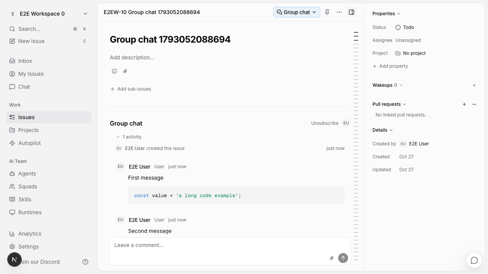
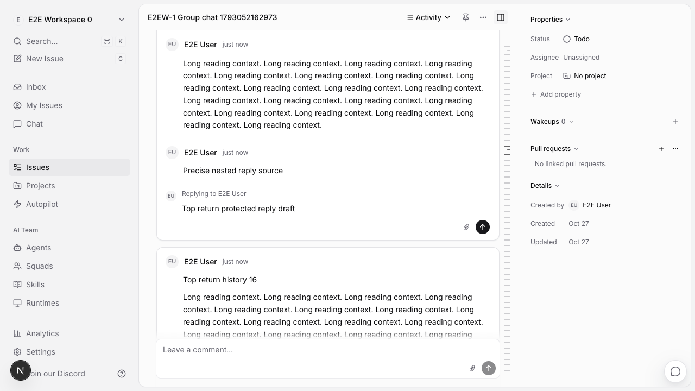

# ZJEX-7 PR delivery audit

## Repository, baseline and authority

- Delivery date: 2026-10-27 (Asia/Shanghai).
- Project: `74eff536-e1ab-4888-8101-ef553c03472a`; its sole bound resource is a local-directory worktree. Its common Git directory is the bound checkout's `.git`; origin is `https://github.com/j-tide/multica.git`.
- Latest fetched `origin/main` and live GitHub main ref: `a097f592be73067d56908ca50ece557fa2af1293`.
- Platform branch remains `agent/agent/zjex-7-1c55ae513f17`; required starting commit `430dd49a028009a087de14422ab16afcd39cc9c4` remains an ancestor. The current private platform worktree is the isolated delivery worktree; no branch switch or separate unrecordable delivery history was used.
- Source baseline: `ec91ce3c809c7030572acdf6dc90cb67d85c0ed2`; frozen candidate: `e58a3cf9b543f6cbe08b7e42845e36bd6cfa3434`.
- Main, source baseline and delivery starting commit have identical trees. Both baseline commits are empty children of the same main commit. No changes from newer main require conflict adaptation.
- Before delivery, Multica linked PRs and GitHub all-state ZJEX-7 PR search were empty; a full remote ref-name scan found no ZJEX/group-chat/issue-chat delivery branch. Live `ls-remote` confirmed main and no existing target `delivery/zjex-7-group-chat`.
- Authorization: trigger `01a17a49-6281-752b-90a7-3538b13f5e1a` permits this task's ordinary branch push and PR creation only. No main push, merge, deployment, production action or final acceptance is authorized. Parent status stays `in_progress` for the lead's verification.
- Direct Git HTTPS timed out; fetch and live ref checks succeeded using a command-scoped proxy matching the machine's existing system proxy. No repository/global network configuration was changed.

## Content equivalence

The source range was materialized as its final 51-file binary diff onto the unchanged delivery baseline. Each file was compared byte for byte with the frozen candidate, then the entire staged tree was compared with `e58a3cf9b^{tree}` before committing.

- Product delivery commit: `c484653135023d339e78557e11ee8253fafe7f7e`.
- Entire product delivery tree and frozen candidate tree: `36301fe1942d289fe30808a1411bf636b40b5426`.
- `git diff e58a3cf9b c484653135023d339e78557e11ee8253fafe7f7e` is empty, including modes and binary assets.
- No conflict adaptation, source repair, compatibility layer or implementation change was introduced by integration.
- The following documentation commit adds only this audit and two byte-identical final-QA screenshots. All original 51 source files remain unchanged.
- Existing worktree `AGENTS.md` is excluded and preserved (SHA256 `662d8888c7ab2859850f98c552d4c24d91e9c70cf7272ab3bc145d13281e68f9`). No local platform state, `.env`, credentials, dependency trees, browser profiles, database, temporary diagnostics or scratch files are staged. Explicit path allowlisting and credential-pattern checks passed.

The source reports are historical snapshots of successive candidates: their then-open failures and then-unperformed actions are preserved as evidence. Current gate state is recorded below; old passing counts are not presented as fresh execution on the final SHA.

## Complete source commit list

```text
27ac1f4ee64b2788cefb885c2c9064425dd11cec feat(issues): add group chat detail view (ZJEX-7)
81f6f89700eab904e4ac33d156d3b7c3d92e0b2c fix(issues): address group chat review regressions (ZJEX-7)
7c71281140efa6f2c6a5929dbf93b2c76dc7f028 fix(issues): stabilize chat reading context and message headers
174f00d329c585f2405d028c336b6f259200c286 fix(issues): delegate annotation edits to source owners
02126a4de3dbb20c7f75b409c039ff3a0a51a79e fix(issues): finish anchor restoration at scroll boundaries
a056c50c335285925dcf1083ae7e58f78ae2b282 fix(issues): preserve unflushed replies across desktop tabs
fe747b93be9be47c04b05c8f7325ae8a36e064dd test(issues): sample reading anchors from the current view
ba0470f0f384572c434b54bb69d87e175f997e56 fix(web): capture reading position before internal navigation
e58a3cf9b543f6cbe08b7e42845e36bd6cfa3434 fix(web): retain zero reading positions across issue route aliases
```

## Integration verification actually executed

Offline frozen-lockfile dependency installation completed successfully. No dependency manifest or lockfile changed. The following task-scoped suites completed with exit 0 on the exact frozen file tree:

| Suite | Files | Tests |
| --- | ---: | ---: |
| Core comment drafts and detail-view preference stores | 2 | 35 |
| Web scroll provider and navigation adapter | 2 | 22 |
| Views projection/menu/detail, composers/retained replies, annotations/chat scroll/shared restore, content editor/uploads/mentions | 12 | 258 |
| Total | 16 | 315 |

```sh
pnpm install --frozen-lockfile --offline
pnpm --filter @multica/core test issues/stores/comment-draft-store.test.ts issues/stores/issue-detail-view-store.test.ts
pnpm --filter @multica/web test platform/scroll-restoration.test.tsx platform/navigation.test.tsx
pnpm --filter @multica/views test issues/components/issue-chat-projection.test.ts issues/components/issue-detail-view-menu.test.tsx issues/components/issue-detail.test.tsx issues/components/comment-composers.test.tsx issues/components/retained-reply-input.test.tsx issues/hooks/use-issue-chat-annotations.test.tsx issues/hooks/use-issue-chat-scroll.test.tsx issues/hooks/use-issue-detail-scroll-restore.test.tsx platform/scroll-restoration.test.tsx editor/content-editor.test.tsx editor/use-coordinated-uploads.test.tsx editor/extensions/mention-view.test.tsx
git diff --cached --check
```

Views emitted jsdom's existing `Not implemented: navigation to another Document` diagnostic; no test failed. Full monorepo checks, Web/Desktop builds, browser E2E, native Electron and Go checks were not repeated during integration: there is no baseline or implementation adaptation. Their existing executed scope remains attributed to the source reports and independent gate evidence below. This turn does not supply a fresh final-SHA binary or independent QA acceptance.

Integration logs are attached to the PR-delivery Multica reply; SHA256:

```text
567b25712fdbcddf20a19b5f4901b7aaea97fd25a71fa7f2aaf973b2f7052f7a  install.log
ef562ffba527be47229de763d0a9f1470ce4b51c51ed1151aedeb7faeab6af3e  core-test.log
d8a48e83b0db7822b1342239374a6305081e20f44781706a225c3eb34cb4321e  web-test.log
b8d22f584cbd50d9f79c735bcd7fc72b1d922a1e5e6143dccfd42e51cf5438f2  views-test.log
```

## Reviewed gates and evidence

- Lead's delivery authorization and no-known-open-blocker summary: comment `01a17a49-6281-752b-90a7-3538b13f5e1a` on Multica issue `01a178ca-2ed9-758a-83d8-4191a22f9b53`.
- Final incremental architecture PASS: comment `01a17a39-f26b-7c01-82de-540963b5661b`, [review evidence](https://multica.ai/api/attachments/01a17a39-f15b-7e1e-a221-ebe06c9f901a/download). Scope: explicit zero semantics and affected provider/shared call chain; 150 canonical checks plus 5 independent checks, with expected failures in the pre-fix counterfactual.
- Final affected design PASS: comment `01a17a3c-3edc-7907-8b80-0031ef1b4fd5`, [design report](https://multica.ai/api/attachments/01a17a3c-2f08-7a5e-844a-58512dc586bc/download). Scope: group-chat middle/top return through UUID and Back; four paths, 35 frames each, no missing comment or offset error, actual draft and exact reply target retained.
- Final independent QA PASS: comment `01a17a46-b074-72fe-be5a-de22f0643c3e`, [QA report](https://multica.ai/api/attachments/01a17a46-a2ee-7d43-a8ec-d282d4cdd7f5/download), [evidence archive](https://multica.ai/api/attachments/01a17a46-a9d3-73d0-808a-7cf768a2d6c8/download). Frozen E2E **10/10**, one whole run without retry; additional activity 2/2, CPU4 mode/path matrix 4/4, controlled RSC checks within the report's limits. Archive SHA256 `ed5845e71fb968067c22e7258d5c4d9826c33b0fd59698da4a9077d2decd1df7`.
- QA-T01 and original line-435 failure separately closed by comment `01a17a28-4e9b-7189-a491-cc12a0f52850`, [report](https://multica.ai/api/attachments/01a17a28-449a-7ec7-986b-d9687e17efdf/download): symptom reproduction, stale 356/4230 chain and product-only counterfactual whole-run evidence. The missing historical first-run frames remain a limitation.
- QA-03 native reply-loss closure: comments `01a179dc-122b-7217-b20c-0722811d9f12` and `01a179e2-f258-7346-944b-e5a60ef6690e`, [report](https://multica.ai/api/attachments/01a179e2-e5f1-7a52-8187-0148a4f14c42/download). On a056: 20 native reply/upload cases, 2 send-503 cases and 4 native window/tab/restart paths; unchanged packages/Desktop/server retain this bounded applicability. The later final QA explicitly checked this unchanged scope, not a rerun of the native matrix.
- Broader executed development typecheck/lint/test and Web/Desktop builds are described in [verification.md](verification.md), [electron-reply-draft-fix.md](electron-reply-draft-fix.md), [reading-return-investigation.md](reading-return-investigation.md) and [zero-return-fix.md](zero-return-fix.md), with each report's candidate and cache/binary limits. They are not all fresh final-candidate executions.

Multica evidence downloads may require workspace access. The actual final-QA images below are also copied into the repository for GitHub review. Images were inspected without editing; they contain synthetic E2E content.

| Image | Source attachment | SHA256 |
| --- | --- | --- |
| [e58-qa-chat-uuid-top.png](screenshots/e58-qa-chat-uuid-top.png) | `01a17a46-adb9-7ed7-a57a-5f77c032c849` | `9b39181c88a503bd4766d0b017536017f7c28fedfe03b737bb8c7060f267590c` |
| [e58-qa-activity-reply-preserved.png](screenshots/e58-qa-activity-reply-preserved.png) | `01a17a46-af7a-73dc-a463-504dd45872c0` | `5c5a51c7141974bbefdcd039334684affe5f4161ea7b33bf72b877454e36d8e9` |





Earlier development light/dark/390px/reply screenshots remain in `output/playwright/zjex-7-*`; those are historical initial-development images, not screenshots recaptured from the final candidate.

## Limits and review handoff

Historical first-failure frame-by-frame evidence is missing. Physical screen readers/touch devices, Windows/Linux, release installers and real agent/daemon scheduling were not covered. Native checks apply to macOS development builds with a fake CLI. Browser checks do not establish all BFCache, cross-document refresh, programmatic navigation, multiwindow or inbox/peek combinations. Early diagnostic setup/context-destroyed failures remain classified in the QA report and are not counted as passing flows.

No application service was started by integration. No environment/database change, deployment, merge or main push occurred. No production backup/restore was needed or tested. The PR remains subject to human review; no deployment rollback has been exercised. CI state and final remote delivery SHA are recorded in the PR-delivery reply after the ordinary push; an in-progress CI run is not reported as passed.

## Complete frozen-source file manifest

Every file below is byte-identical to `e58a3cf9b543f6cbe08b7e42845e36bd6cfa3434`. The audit and two final-QA screenshot copies are the only integration additions outside this manifest.

| File | SHA256 |
| --- | --- |
| `apps/web/platform/scroll-restoration.test.tsx` | `20cfccc4f41cde4832ac3c830d8f243a05717eec611734e7aa4e7720b106983e` |
| `apps/web/platform/scroll-restoration.tsx` | `4fc005ee78b24c2d9593909ff86e54d93a18bf1c296e712d8f760c41417db72b` |
| `artifacts/zjex-7/annotation-controller-fix.md` | `a335b04695e39bd7aa4dccdd69e260dd422ed3255b449a1ac3ff8aad4e95a985` |
| `artifacts/zjex-7/baseline.md` | `05b138cc231d54107cd5be7ed6467a6c8cd839b09a74a5225b1a1efae68eff54` |
| `artifacts/zjex-7/electron-reply-draft-fix.md` | `f1d5b1c27090acaeb50c308cb43b36d53dea30e0cc74bd43642fd54e4af862c0` |
| `artifacts/zjex-7/qa-t01-sampling-fix.md` | `7ea5f9b606c84bbda7cf14532dc7f8e66bbaa54c415c7e159d07b433e2e9b2f7` |
| `artifacts/zjex-7/reading-anchor-fixes.md` | `f752b4e3f6b4a00853e9c3da63acc54a513a4e2e439986984cfe5a24d3d54705` |
| `artifacts/zjex-7/reading-return-investigation.md` | `1bae8daf5d84eeff7c77d6cd373bfe9ec4c8ad2f936ccd946530ddf8353e38ad` |
| `artifacts/zjex-7/review-fixes.md` | `cc4aa53e0a9ea20b6f7814dcf40a209ff1c6b8080042c633cf5f60a2259cbeaa` |
| `artifacts/zjex-7/scroll-boundary-fix.md` | `8e3459250b7679e6297db32cf9718a264a1075b45190c7df0ccfd0396efd75f5` |
| `artifacts/zjex-7/verification.md` | `f2cfbc910c44bf4099bf9018ec0bd0e188c9b675c4225717b3c8ea757d441fc6` |
| `artifacts/zjex-7/zero-return-fix.md` | `056ddadc54c356fe1c829bff1417223c14fc6198c3c18e40cd1adada4e2017e0` |
| `e2e/fixtures.ts` | `4e85bfcadf5c75155f58b2319ac147096ccc9490e2e407f53193d22437507e11` |
| `e2e/issue-chat-view.spec.ts` | `fe035fc1de683d1b9636436b1844fb0bf44adac6b8c3555ec1e2089ca7e3bf3a` |
| `output/playwright/zjex-7-web-chat.png` | `9549ddb1344abbdbf428b3d49ebda8f1f26d7fdb84d217d9c9e079f4886644dc` |
| `output/playwright/zjex-7-web-dark.png` | `2a468cdfb5c2368bb0454deb20adf6196c0dafb48731983bcc8059e12650783f` |
| `output/playwright/zjex-7-web-narrow.png` | `8064ec6c5a07f203cd4f5f717304e78a286e50b5988d6010be6552c37b2c1450` |
| `output/playwright/zjex-7-web-reply-before.png` | `7be17001334d8d5e930cdc61af02b27d0c489ce2b09ad7e13331db2b99fae63d` |
| `packages/core/issues/stores/comment-draft-store.test.ts` | `e30113e3c389ba5f365ed6507c29dbce644e56c88c8aa0a1c3d8990f1ff97ffc` |
| `packages/core/issues/stores/comment-draft-store.ts` | `c3867b62be39e57390779aa354702a72244779040c829e7c9d185b7994bce857` |
| `packages/core/issues/stores/index.ts` | `9574d7dc8873e6f9e29aaff191468784bcd0e785f9396145b3e59ae0376a3383` |
| `packages/core/issues/stores/issue-detail-view-store.test.ts` | `29a85943aae1b41806d8e92220ea84166052b703c967076601aad9c999ef3a8f` |
| `packages/core/issues/stores/issue-detail-view-store.ts` | `8fb0cd75480d0ca5849f1cd9252d0037be84cee9ca6c0301ffc268b8aa6a8e20` |
| `packages/views/editor/content-editor.tsx` | `77fd90b807d7c173aaa95672b78e86cb26d806330a02bb146ebe1c1035d69a1f` |
| `packages/views/editor/extensions/mention-view.test.tsx` | `fda68894533510ee2b55fabbb9d6d0eea440fe67b2b4380489ec348b522f7610` |
| `packages/views/editor/use-coordinated-uploads.test.tsx` | `f9f5aa978cc3f5c876d71d94c17c152c940fbe8a4336d8b1a58dfe826f7c5063` |
| `packages/views/editor/use-coordinated-uploads.ts` | `964ec85cf3b34d86641609948b7a8116c5d1b64aca5d745bbd74ae554f976de8` |
| `packages/views/issues/components/comment-card.tsx` | `01f1d95cb3437cba3e16462c4d965b40716b6fdb26eacba0ce1a36d21252ca83` |
| `packages/views/issues/components/comment-composers.test.tsx` | `8f90760121c87e03ef2af8cade9ef4482fd948eebb75243a6b88e6a73db68a13` |
| `packages/views/issues/components/comment-selection-bubble.tsx` | `db5811fd532fb9a9ceff072b615776cb6862bad90541097db5b58cedb4c1ffc6` |
| `packages/views/issues/components/issue-chat-comment.tsx` | `a0e9edca2e51327bcaaca1fbfe5094d7fc3f9e98d8f7214a88f549f8c659d198` |
| `packages/views/issues/components/issue-chat-projection.test.ts` | `af5602ea072b311654c8fbfa930d2bd3cab19e1e5aadfb474667df6a4065e425` |
| `packages/views/issues/components/issue-chat-projection.ts` | `d609e064841e8d2975aeb8448b312da0cbd247aea175e9170d53c6cd259a2cf1` |
| `packages/views/issues/components/issue-detail-view-menu.test.tsx` | `f51bddaf85e1147aea2219a2bf8d70a0bf81ee98de0209fc4e572b522ef4995c` |
| `packages/views/issues/components/issue-detail-view-menu.tsx` | `e24425925620d2426ef99b4a0631ade13e0b0fae5871905faa520e87933bb08b` |
| `packages/views/issues/components/issue-detail.test.tsx` | `1ce05895bff2d0680c20e9519565416b754f0d8e0bfe4fcb585a81241a121457` |
| `packages/views/issues/components/issue-detail.tsx` | `30f8f9c83715a5f601b254a5260fed26d297ed592c47763337f8ea23efd97344` |
| `packages/views/issues/components/reply-input.tsx` | `b6f52bd5b84d2c48745042e224ca9d2c4c4858a6a57348689a3948981b4ecca7` |
| `packages/views/issues/components/retained-reply-input.test.tsx` | `2f7bbde86af1944031a78d332f7d8ff893cc667d1b5d8b8296d67d5d6b387f20` |
| `packages/views/issues/components/retained-reply-input.tsx` | `6cdc201fc72f5f40fa4897b230069f91acdb837945912e32acd2c0f53fa6f2f4` |
| `packages/views/issues/components/use-comment-annotations.tsx` | `d8f775a67b8ee3af9957bd52de2d5d674919e87799674517dd2fcc0c4a92fc68` |
| `packages/views/issues/hooks/use-issue-chat-annotations.test.tsx` | `ba546d4b00bdb0baa6568a3b323d34701b420a81b4ccbaed658e17d540e85dfa` |
| `packages/views/issues/hooks/use-issue-chat-annotations.tsx` | `9723f07e49fa363ed0e42bdd5c17602a1e843fb16400672423f00aa496f9a688` |
| `packages/views/issues/hooks/use-issue-chat-scroll.test.tsx` | `1f9d8bec1502e6b0492906091d1e4cf4cb8727f9e2f5ef8018a36ef1b390e8e6` |
| `packages/views/issues/hooks/use-issue-chat-scroll.ts` | `ae1ff317a183167506a73c8f75df37f77ebefcf127ba9af0c0aadf3b9d77f559` |
| `packages/views/locales/en/issues.json` | `867dad575375949ffd9a2d584ae87c2e3c48464166a48661b23d4fa33b45d681` |
| `packages/views/locales/fr/issues.json` | `004de7938b8b377e78539869db2ac174b168cc5128610fd1a1608ba48a8c6b78` |
| `packages/views/locales/ja/issues.json` | `972089e49094c211fd2810226bfbeca910d649a04011c226798f23680780a9d0` |
| `packages/views/locales/ko/issues.json` | `fadf838ed62ef42a55009d837f7f51ba81c86db03f0cbe8b524b7a7167d0da35` |
| `packages/views/locales/zh-Hans/issues.json` | `c5b60c769477873a9b559c501748520d09854cbb07b148b6a7d2c59fa605e043` |
| `packages/views/locales/zh-Hant/issues.json` | `4b79f290573c969507b73186b07dc742571ca94ea90e0459f2ecf17ffe21a860` |
